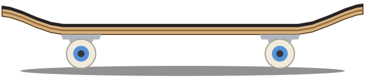
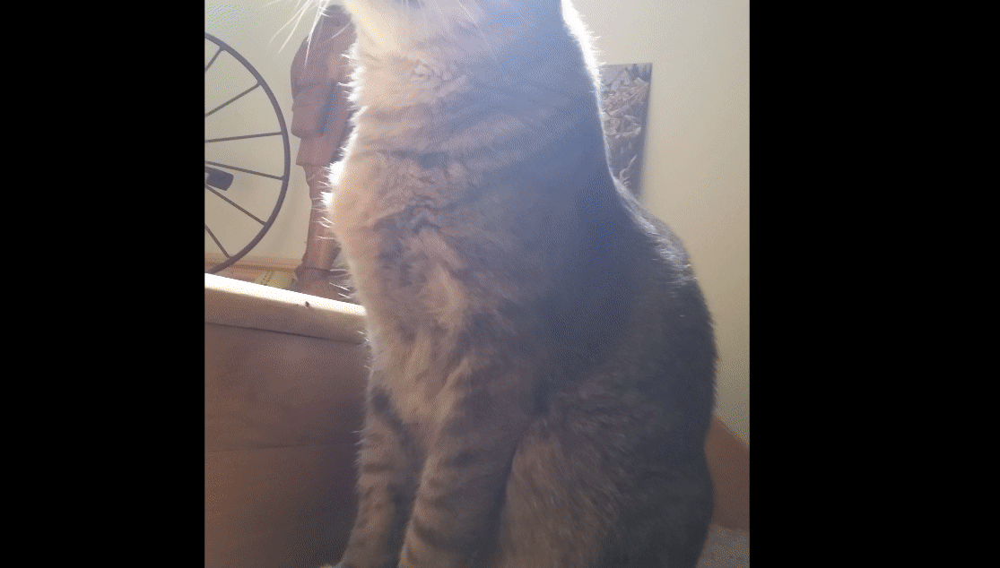

<h1 align="center">Rusty Trucks</h1>

  

Rusty Trucks is a fork of [SK8-ENGINE/skate-3-rust-engine](https://github.com/SK8-ENGINE/skate-3-rust-engine), the Rust and Bevy rewrite of Skate 3. This branch, `hails-additions`, is its rolling build: upstream `main` plus everything we are adding, so you can play the newest work before it is merged upstream.

The name: it is written in Rust, and the trucks are what hold a skateboard's wheels.

> **Early alpha.** Expect bugs and please report them (see [What to test](#what-to-test)). You need your own Skate 3 Xbox 360 disc image; no game files are included.

## Our goals

- **Play like Skate 3.** Systems are ported from Skate 3's own code (read through the [skate3recomp](https://github.com/mchughalex/skate3recomp) recompilation and Ghidra), not guessed. Where something is not decoded yet it is marked "NOT RETAIL YET" until it is.
- **Your disc, your game.** Every value, model, sound and menu movie is read from your own disc during setup. Nothing from the game is in the repository.
- **Built to be modded.** Every system gets a Lua entry point (the mod SDK, API 2) from the start, and the disc's values are defaults a mod can override.
- **Ready for multiplayer.** New systems are written so they can be shared between players later (stable ids, events that can be sent over a network), though there is no networking yet.
- **Upstream first.** Every change has a write-up in [`docs/hails-additions/`](docs/hails-additions/README.md) with the evidence and the tests, and goes to upstream as a pull request.

## Play

The easiest way is the Skate launcher:

  

1. Download `skate-launcher-windows.zip` from the **[hails-additions release](https://github.com/Hailey-Ross/rusty-trucks/releases/tag/hails-additions)** and extract it to a folder of its own.
2. Double-click `build.bat` once. It downloads `SkateLauncher.exe` and starts it.
3. Pick a game folder and your Skate 3 ISO (or an extracted folder with `default.xex`). The first play downloads the newest build and converts your disc once.
4. Later starts update to the newest build on their own and keep a session log of every game.

The launcher ([`tools/steam-launcher`](tools/steam-launcher/README.md)) looks like the flip-out screen of a mid-2000s camcorder ([details](docs/hails-additions/41-launcher-camcorder-viewfinder.md#change)). Add it to Steam as a non-Steam game to start it from the couch with a controller. It can also start upstream `main`, open pull requests, the recomp and retail Skate 3 in RPCS3 side by side for comparing.

Without the launcher: download `skate3rust-windows-x64.zip` from the same release, extract it and start `PLAY-WITH-LOG.bat`. The full setup guide is in the [release notes](https://github.com/Hailey-Ross/rusty-trucks/releases/tag/hails-additions).

You need Windows 10 or 11 (64-bit), a controller (Xbox, PlayStation, Switch or generic) and about 15 GB free.

## Features we added

All of these are in the `hails-additions` build. The [release notes](https://github.com/Hailey-Ross/rusty-trucks/releases/tag/hails-additions) have the details of each.

- **Living world:** NPC skaters riding Skate 3's recorded lines, pedestrians with their behaviours (benches, phone calls, warnings, chases), traffic you can skitch and props you can push, carry and grab.
- **Skate 3's own menus:** the pause menu, Game Settings, Trick Guide with its 3D demo, Extras with cheat codes, Skate Profile and the Challenge Map.
- **Free Play:** Spawn Skater (play as another skater or call up to three to ride with you), traffic and pedestrian density, and the HUD minimap.
- **Loading screen:** Skate 3's tips screen with Coach Frank and your career stats while a map loads.
- **Instant replay:** the last 90 seconds of the whole world with sound, the replay editor and Save to PC.
- **Your DLC:** the DLC maps, Challenge Map folders, skate.Park layouts and teleporters from packs you own.
- **World shading:** Skate 3's lightmaps and shaders for fences, signs, billboards, traffic lights and trees.
- **Audio:** Skate 3's audio engine ported natively, with audio modding (now in upstream `main`).
- **Opt-ins:** everything that is off by default or not Skate 3's lives in one place, the Opt-Ins section of the Guide / F1 / Esc menu.
- **Already in upstream `main` from this fork:** the audio engine, water, retail map spawns, trigger volumes, camera angles, SDL3 gamepads, grind bails at rail bends, see-through fences and the retail menus foundation.

## Features we are working on

- **Career mode and challenges** (upstream draft [#68](https://github.com/SK8-ENGINE/skate-3-rust-engine/pull/68), behind the Challenges opt-in): own the spot challenges are playable, the career core and all 12 Skate 101 tutorials run from your disc; the reward screens and the challenge end screens come next, then more challenge types (races, films, Hall of Meat, contests).
- **Retail startup:** the boot movies, Press Start and the new career welcome (difficulty, camera, team name, Coach Frank), with a cross-platform player for Skate 3's movies.
- **NPC skaters:** finishing their landings, spins and grab releases.
- **Later:** the pros at their challenge spots, the Object Dropper, pedestrians watching you, and multiplayer.

Pull requests to upstream: living world, menus, replay and DLC in [#52](https://github.com/SK8-ENGINE/skate-3-rust-engine/pull/52); career mode and challenges in [#68](https://github.com/SK8-ENGINE/skate-3-rust-engine/pull/68).

## What to test

- Map switches and Challenge Map teleports (the loading screen).
- Free Play's Spawn Skater and the minimap.
- The instant replay and its editor (Back / F6, then A).
- DLC maps and teleporters, if you own the packs.
- Pedestrians and NPC skaters: anything floating, stuck or riding backwards.
- Carrying and pushing props (hold RB next to a bench or bin).
- Skate 3's menus (Start).
- **New:** turn on **Challenges** in the Opt-Ins, ride up to an own the spot and press D-pad Up, and try the Skate 101 tutorials.

**Reporting:** every game the launcher starts saves a session log (without the launcher, use `PLAY-WITH-LOG.bat`). Please say which opt-ins were on, roughly when and where it happened, and attach the log, and a short video if you can, to a [test report](https://github.com/Hailey-Ross/rusty-trucks/issues/new?title=Test%20report%3A%20). One problem per session helps a lot.

## History

Before this rewrite existed, **dumbad** spent more than two years reverse
engineering Skate 3 and building the tools needed to understand and work with
it. That meant countless hours digging through undocumented file formats,
animation data, and game interaction systems, then testing those discoveries
in the original game. Much of that work is collected in
[DumbadsSkate3ModdingTools](https://github.com/Ethanw05/DumbadsSkate3ModdingTools),
including tools for custom maps, meshes, collision, challenges, and DLC.

That research laid the groundwork for this project. Chasm later worked on a
recompilation and a custom renderer based on dumbad's earlier renderer work,
before moving into the Rust/Bevy rewrite. The rewrite's development time tells
only part of the story: the knowledge and tools it relies on took years of
work to establish.

## AI usage

AI coding tools were used to develop this rewrite, but none of it would have
been possible without dumbad's extraordinary effort to reverse engineer the
original game. The AI had years of hard-earned research and working tools to
build on. Describing the project as simply “AI rewriting Skate 3” leaves out
the work that made it possible in the first place.

AI helped turn that knowledge into a new implementation; it does not replace
credit for discovering how the game works. This is still a work in progress,
and using original assets or showing working tricks does not mean every
system behaves exactly like the original.

## Build

Requires Windows, Rust with the MSVC toolchain, and LLVM installed in its default
location. Run `BUILD.bat` to build, then `PLAY.bat` to launch the test world.
`PLAY.bat` opens your saved map (University by default); use the in-game menu to switch maps, or drag a `.skate` file onto `PLAY.bat`. An SDL3-compatible gamepad is required for gameplay;
Escape opens difficulty and graphics settings.

Development builds use a prepared asset set in `assets/private/` or the
installed asset directory. `scripts/Build-Release.ps1` builds the portable Windows
package and requires Python 3.13. GitHub Actions builds `main` automatically;
numbered releases are published separately.

Custom animations and climbing support remain available, but no custom clips
are shipped. The included format-demo map is original procedural content.

Implementation notes are in [`docs/`](docs/). Patched Bevy dependencies and
their licenses are in [`vendor/`](vendor/). This is an unofficial project,
not affiliated with EA.

## Advanced diagnostics

Windows builds support opt-in [performance timeline capture](docs/performance-tracing.md)
through the `--trace` CLI option, including optional GPU pass diagnostics.

## License

Copyright (c) 2026 dumbad and the Skate 3 Rust Engine contributors.
Unless otherwise noted, this project's original code is licensed under the
[GNU General Public License version 3 only](LICENSE) (`GPL-3.0-only`).
You may use, modify, and distribute it, including commercially. If you distribute
a modified version or a binary of the covered software, you must also make its
corresponding source available under GPLv3 and preserve the required notices.

Third-party code retains its existing licenses and copyright notices, including
the vendored Bevy crates and tooling under `tools/vendor/`. This license does
not grant rights to Electronic Arts' game code, data, assets, or trademarks,
or to content supplied by other map and mod authors.
